<!-- Profile README for github.com/kamyab9k — header.svg sits next to this file -->

  

  
  
  
  

 

  I build products end to end — <b>APIs and data layers in Java/Spring Boot</b>, 
  <b>mobile apps and SDKs in Kotlin</b>, and the web pieces that tie them together. 
  Currently doing my M.Sc. in Software Engineering at Universität Hildesheim.

 

## ⚡ What I do

<table>
  <tr>
    <td width="33%" valign="top" align="center">
      <h3>🖥️ Backend</h3>
      
REST APIs, databases and business logic with <b>Java &amp; Spring Boot</b>. Clean architecture, tested and ready to deploy.

    </td>
    <td width="33%" valign="top" align="center">
      <h3>📱 Mobile</h3>
      
Android apps and SDKs with <b>Kotlin &amp; Jetpack Compose</b>, plus cross-platform work with <b>Kotlin Multiplatform</b>.

    </td>
    <td width="33%" valign="top" align="center">
      <h3>🚀 Product</h3>
      
From idea to launch: I design, build and ship my own products — and deploy them live.

    </td>
  </tr>
</table>

 

## 🧰 Stack

  

<!-- Add more by ID, e.g. postgres, mysql, docker, idea, linux — full list at https://skillicons.dev -->

 

## 🚀 Featured work

<table>
  <tr>
    <td width="50%" valign="top">
      <h3>🌱 Gratitude Garden — Couples</h3>
      
Every gratitude you write for your partner grows a new flower in your shared garden. Real-time partner notifications, guided couple questions by topic, freemium model.

      

        
        
      

      <a href="https://gratitude-garden-website-production.up.railway.app/"><b>Website →</b></a> &nbsp;·&nbsp;
      <a href="https://github.com/kamyab9k/Gratitude-Garden-Couples-Documentation"><b>Docs →</b></a>
    </td>
    <td width="50%" valign="top">
      <h3>🧪 KamyabLabs</h3>
      
A live idea-validation web app: drop in a product idea and get structured feedback before you spend weeks building it.

      

        
        
      

      <a href="https://kamyab-ideas-production.up.railway.app/"><b>Try it live →</b></a>
    </td>
  </tr>
  <tr>
    <td width="50%" valign="top">
      <h3>📷 KamVision</h3>
      
Open-source library that makes the Camera2 API painless in Jetpack Compose, without giving up low-level control.

      

        
        
        
      

      <a href="https://github.com/kamyab9k/KamVision"><b>Repository →</b></a>
    </td>
    <td width="50%" valign="top">
      <h3>💪 FitCore</h3>
      
Home workouts with personalized programs, step tracking and an AI-driven personal coach.

      

        
        
      

      <a href="https://github.com/kamyab9k/FitCore-Documentation"><b>Docs →</b></a>
    </td>
  </tr>
</table>

  
<b>🛠️ Currently in the workshop</b>

   

  - **Learnweb Redesign** — a modern UI/UX take on Uni Hildesheim's course platform, built with Kotlin Multiplatform (Android, iOS & web)
  - **Portfolio site** — one home for all my products, coming soon

 

## ✍️ Writing

| | Article | Topic |
|:-:|:--|:--|
| 🧵 | [**Concurrency: From CPU Architecture to Kotlin Coroutines**](https://medium.com/@kamyab9k) <!-- TODO: paste the real article URL --> | CPU fundamentals, threads, and how coroutines modernized concurrency |
| 🤖 | [**Integrating the Gemini API into Android**](https://medium.com/@kamyab9k/how-to-integrate-gemini-api-into-your-android-project-80fe8422a9d8) | Step-by-step guide to adding AI to your Android app |

 

## 📊 GitHub in numbers

  <picture>
    <source media="(prefers-color-scheme: dark)" srcset="https://github-readme-stats.vercel.app/api?username=kamyab9k&show_icons=true&hide_border=true&bg_color=00000000&title_color=3DDC84&icon_color=22D3EE&text_color=CBD5E1&rank_icon=github" />
    
  </picture>
  <picture>
    <source media="(prefers-color-scheme: dark)" srcset="https://streak-stats.demolab.com?user=kamyab9k&hide_border=true&background=00000000&ring=7F52FF&fire=3DDC84&currStreakLabel=3DDC84&sideLabels=CBD5E1&currStreakNum=F8FAFC&sideNums=F8FAFC&dates=64748B" />
    
  </picture>

 

  Built with ☕, Kotlin and too many late nights · Let's build something together

